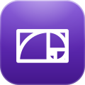
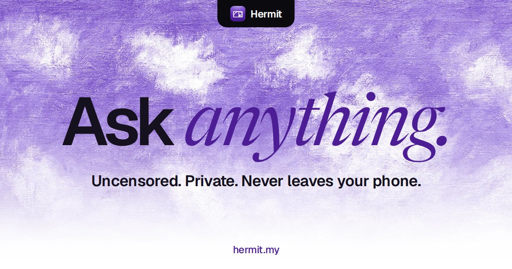

<p align="center">
  <a href="https://hermit.my"></a>
</p>

<h1 align="center">hermit.my</h1>

<p align="center">
  The website for <b>Hermit</b>, a private AI that lives on your iPhone.<br>
  <a href="https://hermit.my">hermit.my</a> · <a href="https://x.com/hermitai_">@hermitai_</a>
</p>

<p align="center"></p>

---

Hermit downloads a small language model once, then answers everything on the device. Turn on flight mode and it keeps
working, because nothing it does needs a server. This repository is the landing page that explains that and runs the
beta waitlist.

## What's here

```
public/
  index.html          one page, no framework
  css/base.css        design tokens (light and dark), buttons, theme switch, toasts
  css/site.css        the page: notch navbar, hero, product stage, sections, join sheet
  js/theme.js         theme before first paint, the theme switch, toasts
  js/liquid.js        edge refraction for the glass surfaces (Chromium; frosted glass elsewhere)
  js/site.js          navbar shape, scroll reveals, the join sheet, the product stage
  art/                paintings, 3D icons, partner marks, the crab
  brand/              the spiral mark and app icon
scripts/deploy.sh     publish to Cloudflare Pages
```

There is no build step. Every file in `public/` is served as it is.

## Run it

```sh
python3 -m http.server 8080 --directory public
```

Open <http://localhost:8080>. The page reads `hermit-theme` from `localStorage`, so clear it to fall back to the system
theme.

## Deploy

```sh
CLOUDFLARE_API_TOKEN=... CLOUDFLARE_ACCOUNT_ID=... scripts/deploy.sh
```

The Pages project is `hermit-my`; `hermit.my` and `www.hermit.my` point at it.

## Design notes

- **Type.** Geist for everything, Newsreader italic for the one accent word in a headline, Geist Mono for small labels.
- **Colour.** Pure white and near-black rooms, with the brand purple `#4D1D95` kept for the mark, the accent word and
  the swap preview. Every colour is a token in `base.css`, redefined for dark.
- **The navbar** is a notch that hangs from the top edge. Its outline is drawn from its own size in `site.js`, so it
  stays exact at any width. Black in light mode, white glass in dark.
- **Glass.** `liquid.js` draws a displacement map per element and uses it as a `backdrop-filter`, so the page bends at
  the rim like a thick slab. Browsers without SVG backdrop filters get the frosted version from the CSS.
- **Motion** respects `prefers-reduced-motion` everywhere.

## Credits

Paintings by Claude Monet (*Cliff Walk at Pourville* and *Cliffs at Pourville*, 1882), public domain; sources in
`public/art/credits.json`. 3D icons from [Microsoft Fluent Emoji](https://github.com/microsoft/fluentui-emoji) (MIT).
x402, Stripe, Apple, App Store and TestFlight marks belong to their owners.

© 2026 Hermit
